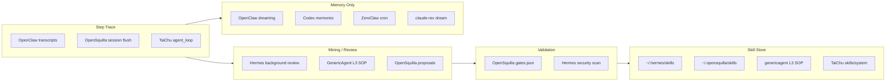

# 八仓库源码深度分析

> **方法**：本机直接读源码（`/Users/maybewu/Documents/Projects/`），非 README 摘要。  
> **范围**：8 仓库 × 7 维度；末尾映射 SkillRL / Claw-R1。  
> **TaiChu** 为私有 Gitea；其余 7 个均为开源，路径已验证。

---

## 评估维度（7 问）

| # | 维度 | 问什么 |
|---|------|--------|
| Q1 | **Skill 表示** | 文件格式、目录布局、元数据 |
| Q2 | **生命周期** | 加载、注入 prompt、执行、卸载 |
| Q3 | **自动生成** | 轨迹/失败 → 新 skill 的闭环 |
| Q4 | **自动更新** | 已有 skill 的 patch / revision |
| Q5 | **退役/排序/版本** | 淘汰、ranking、版本控制 |
| Q6 | **Harness 协同进化** | compaction / dreaming / cron 与 skill 联动 |
| Q7 | **vs SkillRL / Claw-R1** | 对应论文哪一层、缺什么 |

---

## 总览矩阵

| 仓库 | Q1 表示 | Q2 生命周期 | Q3 自动生成 | Q4 自动更新 | Q5 退役/版本 | Q6 Harness 协同 | Q7 论文映射 |
|------|---------|------------|------------|------------|-------------|----------------|------------|
| **hermes-agent** | SKILL.md + 子目录 | 启动加载 → prompt 元数据；`load_skill` 按需 | ✅ 后台 review + `skill_manage create` | ✅ `edit`/`patch` | ⚠️ 无 ranking/版本 | ⚠️ memory review 并行，非 GRPO | SkillRL 运行时 CRUD 碎片 |
| **opensquilla** | SKILL.md + gates.json | 分层 BUNDLED/MANAGED；proposal 暂存 | ✅ meta-skill-creator → proposals | ✅ accept 晋升 MANAGED | ✅ gates + auto_enable 审计 | dream factory + session flush → **memory** | Claw-R1 step trace 近；缺 SkillBank |
| **genericagent** | L3 `*_sop.md`（非 SKILL.md） | SOP 文件 + working memory 引用 | ⚠️ agent 自驱写 SOP | ⚠️ `file_patch` 更新 L2/L3 | ❌ 无 | compaction 式 checkpoint；`/morphling` | Failure→Skill 概念最接近 |
| **openclaw** | SKILL.md ~83 bundled | ClawHub + workspace skills | ❌ skill-creator 仅指南 | ❌ 人工/技能包 | ❌ | ✅ dreaming 3-phase → MEMORY.md；compaction-safeguard | Claw-R1 gateway 同类；memory≠skill |
| **codex** | SKILL.md ~18 samples | ext/skills catalog + selection | ❌ | ❌ 用户管理 | ❌ | ✅ memories 2-phase distill（harness 非 skill） | Improvement Loop 对标 harness |
| **zeroclaw** | 用户 workspace，无 bundled | skills loader 读目录 | ❌ | ❌ | ❌ | ✅ nightly consolidation cron（memory） | 仅 memory 侧碎片 |
| **claude-code-rev** | 2 bundled skills | memdir + skill registry | ❌ | ❌ | ❌ | ✅ auto-dream 4-phase → memdir | 参考实现，memory only |
| **TaiChu** | 17 canonical SKILL.md | ResourceLoader + `load_skill` 双维度 wire | ❌ planned | ❌ | ❌ | compaction 仅 summarization | 集成目标；有跨仓对比 doc |

**图例**：✅ 有明确代码路径 | ⚠️ 部分/软触发 | ❌ 未见

---

## 1. hermes-agent

**路径**：`/Users/maybewu/Documents/Projects/oss/hermes-agent`

### Q1 — Skill 表示

- 标准 Agent Skills：`skills/{name}/SKILL.md` + 可选 `references/`, `templates/`, `scripts/`, `assets/`
- 用户/agent 创建的技能统一在 `~/.hermes/skills/`
- YAML frontmatter：`name`, `description`；与社区 Skills 标准一致

### Q2 — 生命周期

- 启动：`build_skills_system_prompt()` 注入 skill 元数据列表
- 按需：`skills_list`, `skill_view` 浏览；无独立 load 工具（内容通过 view 拉取）
- 执行：skill 内容作为 procedural knowledge 指导后续 tool 调用

### Q3 — 自动生成

**最强闭环之一。** 后台线程在 turn 结束后 fork 一个 quiet `AIAgent`，用专用 prompt 审视对话：

```1768:1776:/Users/maybewu/Documents/Projects/oss/hermes-agent/run_agent.py
    _SKILL_REVIEW_PROMPT = (
        "Review the conversation above and consider saving or updating a skill if appropriate.\n\n"
        "Focus on: was a non-trivial approach used to complete a task that required trial "
        "and error, or changing course due to experiential findings along the way, or did "
        "the user expect or desire a different method or outcome?\n\n"
        "If a relevant skill already exists, update it with what you learned. "
        "Otherwise, create a new skill if the approach is reusable.\n"
        "If nothing is worth saving, just say 'Nothing to save.' and stop."
    )
```

触发条件（`run_agent.py` ~9604）：每 turn 累计 tool iteration ≥ `creation_nudge_interval`（默认 10）且 `skill_manage` 在 valid tools 中。

### Q4 — 自动更新

`skill_manage` 支持 `create | edit | patch | delete | write_file | remove_file`：

- `edit`：整文件替换 SKILL.md
- `patch`：find-and-replace 级局部更新
- 写后 `_security_scan_skill()` — 与 hub 安装同等安全扫描

### Q5 — 退役/排序/版本

- 无 SkillBank ranking、无 semantic version、无自动退役
- `delete` 可手动移除用户 skill
- 大小限制：`MAX_SKILL_CONTENT_CHARS = 100_000`

### Q6 — Harness 协同进化

- Memory review 与 skill review **并行**（`_COMBINED_REVIEW_PROMPT`），同样后台 fork
- Memory：`MEMORY.md` + external memory providers
- **无** RL、无 step-level trace pool、无 validation gate 后再 promote

### Q7 — vs SkillRL / Claw-R1

| 论文组件 | Hermes 对应 | 缺口 |
|---------|------------|------|
| SkillRL SkillBank | `~/.hermes/skills/` 文件树 | 无 embedding retrieval、无 success-rate ranking |
| SkillRL GRPO evolution | — | 无训练环 |
| SkillRL recursive distill | 后台 LLM review | 无 structured failure mining |
| Claw-R1 Step Data Pool | trajectory 存本地 | 无 step-level middleware / RPC |
| Claw-R1 Gateway | — | 非 gateway 架构 |

**结论**：**运行时 procedural memory CRUD 最完整**的开源样本；缺 validation layer 和 graph retrieval。

---

## 2. opensquilla

**路径**：`/Users/maybewu/Documents/Projects/oss/opensquilla`

### Q1 — Skill 表示

- `skills/bundled/` — ~91 个 BUNDLED SKILL.md
- `~/.opensquilla/skills/{name}/` — MANAGED 层（accept 后）
- `~/.opensquilla/proposals/{8-hex}/` — 暂存：`SKILL.md` + `gates.json`

### Q2 — 生命周期

三层：

```
BUNDLED (只读) → proposals (候选) → MANAGED (用户/agent 可执行)
```

- Meta-skills：手动 `/meta <name>` 触发（默认不 auto_trigger）
- `meta-skill-creator`：把重复 multi-skill 协作模式 → 新 MetaSkill proposal

### Q3 — 自动生成

`proposals_lib.atomic_write_proposal()` — 原子写入 proposal 目录：

```44:69:/Users/maybewu/Documents/Projects/oss/opensquilla/src/opensquilla/skills/proposals_lib.py
def atomic_write_proposal(
    home: Path, skill_md: str, gates: dict,
) -> str:
    """Materialise a proposal directory atomically.
    ...
    """
    ...
    (tmp_dir / "SKILL.md").write_text(skill_md, encoding="utf-8")
    (tmp_dir / "gates.json").write_text(
        json.dumps(gates, indent=2, ensure_ascii=False),
        encoding="utf-8",
    )
    ...
    tmp_dir.rename(final_dir)
    return proposal_id
```

`gates.json` 含 risk level、auto_enable 资格、validation profile — **最接近 product-grade skill gate**。

### Q4 — 自动更新

- `accept_proposal()`：gates 全通过 → `shutil.move` 到 MANAGED；否则 `refused`
- `reject_proposal()` 丢弃
- `read_auto_propose_settings()` / `write_auto_propose_settings()` — 可配置自动 propose 行为
- `list_auto_enabled_skills()` — 审计 auto-enable 历史

### Q5 — 退役/排序/版本

- gates 未通过 = 无法晋升（软 block）
- 同名 skill 已存在则 refuse
- 无 git-style skill versioning；有 auto_enable audit trail

### Q6 — Harness 协同进化

- **Session flush**（`memory/session_flush.py`）：session reset 时 distill → memory_save
- **Dream factory**（memory/dream/）：与 skill 分离，服务 declarative memory
- Skill 与 memory **管道分离**，但 proposal gate 设计可复用到 skill validation

### Q7 — vs SkillRL / Claw-R1

| 论文组件 | OpenSquilla 对应 | 缺口 |
|---------|-----------------|------|
| SkillRL validation (SkillOpt/SkillHone) | gates.json + acceptance | 无 automated benchmark run |
| SkillRL SkillBank | MANAGED layer | 无 RL ranking |
| Claw-R1 step trace | session messages + flush obligations | 有 obligation 提取，无 universal step RPC |
| Claw-R1 data pool | proposals dir | 结构类似 candidate pool |

**结论**：**Skill 候选 → Gate → Promote** 产品化程度最高；memory dreaming 强但不在 skill 环内。

---

## 3. genericagent

**路径**：`/Users/maybewu/Documents/Projects/oss/genericagent`

### Q1 — Skill 表示

**不用 SKILL.md。** 自进化单元是 **L3 SOP**：

```
memory/
├── L0  memory_management_sop.md      # 更新协议
├── L1  (index)
├── L2  环境事实
├── L3  *_sop.md                      # 任务级程序知识
└── L4_raw_sessions/                  # 原始会话 + salient mining
```

`morphling_sop.md`, `incubator_sop.md` 等 = 领域 skill 等价物。

### Q2 — 生命周期

- Agent 通过 `file_read` 按需读 SOP
- `working['related_sop']` 在 prompt 中提示重读
- 每 10 turn 注入 `get_global_memory()` 提醒记忆层级

### Q3 — 自动生成

`do_start_long_term_update()` — agent **自判断**任务完成后调用：

```508:523:/Users/maybewu/Documents/Projects/oss/genericagent/ga.py
    def do_start_long_term_update(self, args, response):
        '''Agent觉得当前任务完成后有重要信息需要记忆时调用此工具。'''
        prompt = '''### [总结提炼经验] ...
**只能提取行动验证成功的信息**：
- **环境事实** → `file_patch` 更新 L2，同步 L1
- **复杂任务经验** → L3 精简 SOP
...
''' + get_global_memory()
```

`/morphling` — 专门用于 SOP 结晶的子流程（morphling_sop.md）。

### Q4 — 自动更新

- L2：`file_patch` 最小修改
- L3：agent 写新 SOP 或 patch 现有
- 严格 L0 SOP 约束：先 read → 判断类型 → 最小更新

### Q5 — 退役/排序/版本

- `memory_cleanup_sop.md` 存在但未形成自动 ranking
- 无 version field；靠文件命名 + 人工结构

### Q6 — Harness 协同进化

- Turn 7/10/25/175 checkpoint 注入 — **prompt-level harness 进化**
- L4 salient mining SOP — 会话 → 要点
- 无 nightly cron；靠 turn 模数 + agent 自驱

### Q7 — vs SkillRL / Claw-R1

| 论文组件 | GenericAgent 对应 | 缺口 |
|---------|------------------|------|
| SkillRL Failure→Skill | L3 SOP 从失败结晶 | 无结构化 failure tag |
| SkillRL Trajectory→Skill | L4 + long_term_update | 无 batch mining |
| Claw-R1 | — | 无 step middleware |

**结论**：**SOP-as-skill 哲学最一致**；自标 "self-evolving" 名副其实，但非 Agent Skills 标准、无 gate/validation。

---

## 4. openclaw

**路径**：`/Users/maybewu/Documents/Projects/oss/openclaw`

### Q1 — Skill 表示

- `skills/` ~83 bundled SKILL.md
- ClawHub registry + user workspace skills
- `skill-creator` bundled — **创作指南**，非自动 pipeline

### Q2 — 生命周期

- Gateway 启动加载 skill catalog
- Skills 作为 prompt 扩展；工具通过 skill scripts/ 暴露
- 与 memory-core **解耦**

### Q3 — 自动生成

- ❌ 无 runtime skill CRUD
- `skill-creator` 教 agent **如何写** SKILL.md，需人工或显式 invoke

### Q4 — 自动更新

- ❌ 无 auto patch
- Compaction 可能 re-distill **conversation context**，不写回 skill 文件

### Q5 — 退役/排序/版本

- ❌
- ClawHub 有社区 versioning；runtime 无 SkillBank ranking

### Q6 — Harness 协同进化

**Dreaming**（`extensions/memory-core`，`docs/concepts/dreaming.md`）：

| Phase | 作用 | 写 MEMORY.md |
|-------|------|:------------:|
| Light |  staging short-term | No |
| Deep | score + promote | **Yes** |
| REM | theme reflection | No |

`short-term-promotion.ts` — recall tracking → promotion scoring（`minScore`, `minRecallCount`, `minUniqueQueries`）。

**Compaction-safeguard**（`src/agents/pi-hooks/compaction-safeguard.ts`）— adaptive chunk ratio、tool failure summary、structured fallback — **harness 质量**，非 skill evolution。

### Q7 — vs SkillRL / Claw-R1

| 论文组件 | OpenClaw 对应 | 缺口 |
|---------|--------------|------|
| Claw-R1 Gateway | ✅ 多 channel gateway | step-level pool 未开源在此 repo |
| Claw-R1 trace | session transcripts → dreaming corpus | 有 ingestion，无 RL export |
| SkillRL SkillBank | skills/ 静态 | 无 evolution loop |
| SkillRL memory distill | Deep phase promotion | 目标是 MEMORY.md 非 SKILL.md |

**结论**：**最大开源 harness + memory promotion**；skill 层静态，evolution 在 memory 维。

---

## 5. codex (openai/codex)

**路径**：`/Users/maybewu/Documents/Projects/oss/codex`

### Q1 — Skill 表示

- `codex-rs/ext/skills/` — catalog, provider, selection, sources
- ~18 sample SKILL.md
- Host skill provider 插件架构

### Q2 — 生命周期

- `SkillProviders` 聚合多 source
- Selection 决定注入哪些 skill metadata
- Skills 与 **memories 完全分离模块**

### Q3 — 自动生成

- ❌ Skills 用户/团队管理
- Memories 有 auto-write（rollout → distill）

### Q4 — 自动更新

- ❌ skill 无 auto patch
- Memories：`consolidation.md` template — INIT/UPDATE phase，git-style diff 驱动

### Q5 — 退役/排序/版本

- Memories 有 task-group consolidation + epistemic status
- Skills 无 ranking

### Q6 — Harness 协同进化

**Memories 2-phase**（`codex-rs/memories/write/templates/`）：

1. **Stage one**：rollout → raw memory + task blocks
2. **Consolidation**：→ `memory_summary.md` + structured artifacts

Improvement Loop（官方 blog）优化 **harness prompts/rules**，非 Skill Library。

`phase2_workspace_diff.md` — 增量 consolidation，类似 git diff driven update。

### Q7 — vs SkillRL / Claw-R1

| 论文组件 | Codex 对应 | 缺口 |
|---------|-----------|------|
| SkillRL | — | 无 SkillBank RL |
| Claw-R1 step pool | rollout summaries | 粗粒度 task-level，非 step RPC |
| Harness co-evolution | Improvement Loop + memories | ✅ 官方最强 harness 进化 |

**结论**：**官方标杆：memory/harness 进化**；Skills 基础设施就绪，**刻意不做 skill self-evolution**。

---

## 6. zeroclaw

**路径**：`/Users/maybewu/Documents/Projects/oss/zeroclaw`

### Q1 — Skill 表示

- `src/skills/` loader — 读用户 workspace
- **0 bundled skills** — 极简 runtime

### Q2 — 生命周期

- 标准目录 scan → inject
- 无 bundled meta-skills

### Q3–Q5 — 生成/更新/版本

- ❌ 全无

### Q6 — Harness 协同进化

**Nightly consolidation cron**（`src/cron/consolidation.rs`）：

```13:49:/Users/maybewu/Documents/Projects/oss/zeroclaw/src/cron/consolidation.rs
const CONSOLIDATION_PROMPT: &str = "\
You are running a nightly memory consolidation job. ...
1. Use `cron_runs` to review recent job execution results ...
2. Use `memory_recall` to retrieve today's Daily memories ...
...
5. Store the summary using `memory_store` with category \"core\" ...
6. If the workspace file `MEMORY.md` exists, ... append a dated section ...
```

- 3:00 AM cron，`SessionTarget::Isolated`
- Agent 用现有 tools 自驱 consolidate — **prompt-driven**，非硬编码 pipeline

### Q7 — vs SkillRL / Claw-R1

- 仅 **memory consolidation 碎片**
- 可作为 TaiChu 轻量 cron 参考实现

---

## 7. claude-code-rev (oboard)

**路径**：`/Users/maybewu/Documents/Projects/oss/experimental/claude-code-rev`

### Q1 — Skill 表示

- 2 bundled skills（含 `/dream`）
- **memdir** 为主记忆系统：`MEMORY.md`, daily logs, topic files

### Q2 — 生命周期

- `src/memdir/` — paths, scan, findRelevantMemories, memoryTypes
- Skills 注册于 `src/skills/bundled/`

### Q3–Q5 — 生成/更新/版本

- ❌ Skill 无 auto CRUD
- Memory 通过 dream 更新

### Q6 — Harness 协同进化

**Auto-dream**（`src/services/autoDream/consolidationPrompt.ts`）— 4-phase：

1. Orient — ls memory dir, read index
2. Gather — daily logs, transcript grep
3. Consolidate — merge into topic files
4. Update index

`DreamTask.ts` — UI 层 background task；与 OpenClaw dreaming 概念平行。

Cron：`src/utils/cronTasks.ts` — dream task 不参与 age-out。

### Q7 — vs SkillRL / Claw-R1

- **Memory consolidation 参考实现**（社区还原 Claude Code）
- 对 TaiChu / OpenClaw dreaming 设计有逆向参考价值
- 无 skill evolution

---

## 8. TaiChu（私有）

**路径**：`/Users/maybewu/Documents/Projects/drafts/zk/TaiChu`

### Q1 — Skill 表示

- 17 canonical：`skills/system/{name}/SKILL.md`
- Frontmatter 扩展：`skill_type`, `runs_on`, `triggers`, `when_not`
- 已有 1000+ 行跨仓对比：`docs/architecture/skill-system-cross-repo-comparison.md`

### Q2 — 生命周期

`DefaultResourceLoader`（`core/agent-session/src/resource_loader.rs`）：

- Scan `skills/` 目录 → parse SKILL.md
- `get_skills()` → inject system prompt
- **`load_skill` 双维度 wire**（`taichu-service/tools/a_system/`）：
  - LLM 视角：`load_skill({name})` snake_case
  - Device wire：`SkillLoad` PascalCase — 端云 skill 执行

`skill_name_filter` — Toollery gate 测试用

### Q3 — 自动生成

- ❌ **planned**，无 runtime proposal pipeline
- 无 agent CRUD skill tool

### Q4 — 自动更新

- ❌
- Skill snapshots 存在但非 auto-evolution

### Q5 — 退役/排序/版本

- ❌
- Canonical 17 人工 curated

### Q6 — Harness 协同进化

`compaction.rs` — **纯 context summarization**：

- `should_compact()` token threshold
- LLM summarize old messages → free context
- **不写 skill / memory 文件**

Gap vs OpenClaw dreaming / Hermes review：**compaction 后无 distill-to-skill 步骤**。

### Q7 — vs SkillRL / Claw-R1

| 论文组件 | TaiChu 现状 | 建议集成 |
|---------|------------|---------|
| Claw-R1 step trace | agent_loop messages | 加 step export middleware |
| SkillRL SkillBank | 17 static skills | + MANAGED layer |
| SkillRL failure mining | — | post-compaction review fork |
| OpenSquilla gates | — | proposals_lib 模式 |
| Hermes skill_manage | — | Rust/Python tool 移植 |

**结论**：**Skill 加载/端云执行最强**；**evolution loop 全缺** — 集成目标明确。

---

## 跨仓库：谁实现了什么环？



| 闭环阶段 | 最强实现 | 次选 |
|---------|---------|------|
| Step-level capture | OpenSquilla flush obligations | OpenClaw dreaming corpus |
| Trajectory→Skill | Hermes `_SKILL_REVIEW_PROMPT` | GenericAgent L3 crystallization |
| Failure→Skill | GenericAgent（验证成功才写） | Hermes trial-and-error 检测 |
| Skill Revision | Hermes `patch` | GenericAgent `file_patch` |
| Validation gate | **OpenSquilla gates.json** | Hermes security scan |
| Versioned library | OpenSquilla MANAGED | Hermes flat files |
| Graph retrieval | ❌ 全无 | — |
| RL / GRPO | ❌ 全无 | SkillRL 论文 only |
| Harness co-evolution | Codex Improvement Loop | OpenClaw compaction-safeguard |

---

## SkillRL × Claw-R1 对照：八仓库覆盖度

| 论文层 | 组件 | 八仓库覆盖 |
|--------|------|-----------|
| **Claw-R1** | Gateway | OpenClaw ✅, OpenSquilla ✅, TaiChu 端云 ✅ |
| **Claw-R1** | Step Data Pool | 无完整实现；OpenSquilla obligations ≈ 30% |
| **Claw-R1** | Step RPC export | ❌ |
| **SkillRL** | SkillBank | Hermes/OpenSquilla/TaiChu 有静态库 |
| **SkillRL** | Failure mining | Hermes soft, GenericAgent conceptual |
| **SkillRL** | GRPO recursive evolution | ❌ |
| **SkillRL** | SkillOpt validation | OpenSquilla gates ≈ 50% |
| **Combined** | Full closed loop | **无单一 repo** |

---

## 对 TaiChu 集成的优先建议

基于源码证据，而非愿景：

| 优先级 | 从哪里搬 | 搬什么 | TaiChu 落点 |
|:------:|---------|--------|------------|
| P0 | Hermes | `_spawn_background_review` + skill review prompt | `compaction.rs` 之后 async fork |
| P0 | Hermes | `skill_manage` CRUD + security scan | 新 tool in taichu-service |
| P1 | OpenSquilla | `proposals_lib` + gates.json | `~/.taichu/proposals/` |
| P1 | OpenClaw | dreaming Deep phase scoring | memory promotion（若做 memory） |
| P2 | GenericAgent | L0 memory_management_sop 协议 | skill update SOP |
| P2 | ZeroClaw | consolidation cron pattern | isolated session cron |
| P3 | Codex | phase2 diff-driven consolidation | harness rules 增量更新 |

---

## 源码索引（本分析引用）

| 仓库 | 关键文件 |
|------|---------|
| hermes-agent | `run_agent.py` (1753–1830, 9604–9630), `tools/skill_manager_tool.py` |
| opensquilla | `src/opensquilla/skills/proposals_lib.py`, `memory/session_flush.py` |
| genericagent | `ga.py` (508–523), `memory/memory_management_sop.md` |
| openclaw | `extensions/memory-core/src/short-term-promotion.ts`, `docs/concepts/dreaming.md`, `src/agents/pi-hooks/compaction-safeguard.ts` |
| codex | `codex-rs/memories/write/templates/`, `codex-rs/ext/skills/src/lib.rs` |
| zeroclaw | `src/cron/consolidation.rs` |
| claude-code-rev | `src/services/autoDream/consolidationPrompt.ts`, `src/memdir/` |
| TaiChu | `core/agent-session/src/resource_loader.rs`, `compaction.rs`, `services/rust/taichu-service/src/tools/a_system/` |

---

## 变更记录

| 日期 | 说明 |
|------|------|
| 2026-07-08 | 初版：8 仓库 × 7 维源码深度分析 + SkillRL/Claw-R1 映射 |
