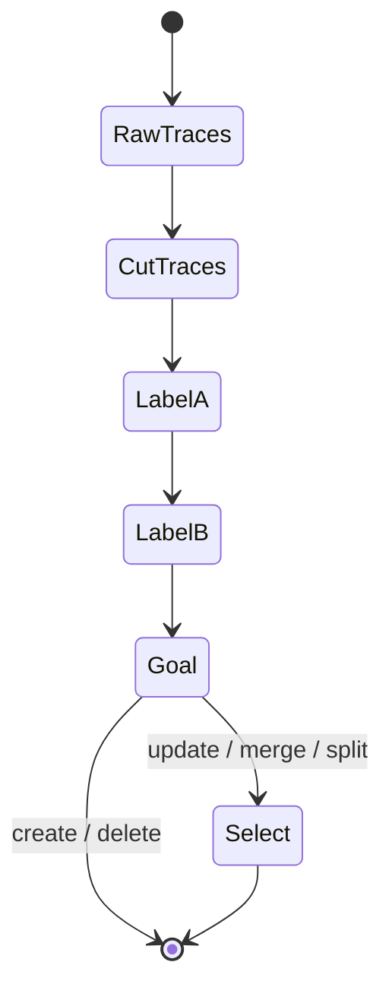
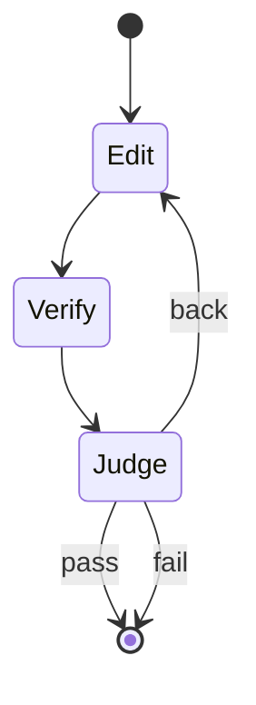

# Evolver workflow

How a container runs one session is `run-guide.md`.

Two agents, two images. Each image has only that agent's skills. The label agent writes labels and matches skills. The optimize agent then loops over the goal, one op at a time. create, update, and delete name one skill. merge and split name two. Data drives each step. Thresholds are tunable. A skill states experience, what not to do, what must be done, and where it applies.

The label agent stops when the goal names the skills. It does not edit a skill and it does not verify one.

The optimize agent runs that loop once per goal op. Edit is Update, Generate, Delete, Merge, or Split for that op. `pass` ends the op. `fail` ends the op after its one retry. `back` returns to Edit for that same op. The label agent does not run again.

| Step | State | Does | Reads | Writes |
|---|---|---|---|---|
| | RawTraces | New traces, read only | `workspace/traces/target_agent_traces`, optional `workspace/traces/reference_agent_traces_optional` | |
| step1 | CutTraces | Cut traces into related topics. A trace that fits no topic stays unassigned | `workspace/traces/target_agent_traces`, optional `workspace/traces/reference_agent_traces_optional`, `evolver_skills/step1-cut-traces`, `evolver_skills/step1-cut-traces/cut-traces.example.json` | Topic slices in `workspace/traces/derived_traces` |
| step2 | LabelA | Demand side. Analyze the derived traces and the gaps. Label the improvement areas that are needed | `workspace/traces/derived_traces`, `data/skill_capabilites`, `evolver_skills/step2-dignosis/evolve-goal-checker.py`, `evolver_skills/step2-dignosis/diagnosis.example.json` | `workspace/run/diagnosis.json` |
| step3 | LabelB | Label each existing skill until it has at least 3 labels, each with a weight | `evolver_skills/step3-existing_skills_labeler`, `data/skill_capabilites`, `workspace/target/to_be_improved_skills` | `workspace/target/to_be_improved_skills_metadata/metadata.json` |
| step4 | Goal | Choose the action: create, update, delete, merge, or split | Label A, `evolver_skills/step4-goal-generator`, `evolver_skills/step4-goal-generator/evolve-goal.example.json`, `evolver_skills/step4-goal-generator/one_action.py`, `evolver_skills/reference-skill_format/skill_format.json` | `workspace/run/evolve-goal.json` |
| step5.1 | Select | For update, merge, and split only. Match Label A to Label B and pick the targeted skills | `workspace/run/diagnosis.json`, `metadata.json`, `evolver_skills/step5.1-skill-select/skill_type_checker.py` | `improve_skills` on the goal |
| | Update | Copy the skill into `raw_skills` if it is not there, then update the copy under `to_be_improved_skills` | Goal, `workspace/target/raw_skills` | `workspace/target/to_be_improved_skills` |
| | Merge | Merge the matched skills | Goal | `workspace/target/to_be_improved_skills` |
| | Split | Split a matched skill | Goal | `workspace/target/to_be_improved_skills` |
| | Delete | Delete the skill named by the goal. No Label A to Label B match | Goal | `workspace/target/to_be_improved_skills` |
| step5.2.1 | Generate | Create a skill. No Label A to Label B match | Goal, `evolver_skills/step5.2.1-skill-create` | New skill under `workspace/target/` |
| step5.2.2 | Generate | Record an out-of-distribution gap on the same create branch | Goal, `evolver_skills/step5.2.2-ood-data-updater`, diagnosis | `newly_detected_skill_capabilites_missing` stays on the diagnosis |
| step6 | Verify | Checklist and goal alignment. Compare each raw skill with the improved skill. Write status and feedback. Do not choose pass or back | `evolver_skills/step6-verifiter`, `evolver_skills/step6-verifiter/verification-output.example.json`, `evolver_skills/step6-verifiter/verification_from_goal.py`, `evolver_skills/step6-verifiter/verify_deleted.py`, `evolver_skills/step6-verifiter/verify_sections.py`, `evolver_skills/step6-verifiter/verify_goal.py`, `workspace/run/evolve-goal.json`, `target/raw_skills`, `target/to_be_improved_skills` | overall and per-skill status, feedback, and `ood` in `workspace/run/verification.json` |
| step7 | Judge | Read this op's verifier output. Stop, or send this op back to Edit once | `workspace/run/verification.json`, the goal op | `feedback.action`. `pass` and `fail` end the op. `back` re-enters Edit |

`reference-skill_format` is the shared section and directory list. It is not a state. Select, update, merge, and split are one branch. Create and the out-of-distribution record are the other branch, so they are step 5.2.1 and step 5.2.2. Update, merge, split, and delete have no skill folder. `z-new-data-format-generator` is the old Cluster skill and is not on this machine.

The label agent is steps 1 through 5.1. The optimize agent is the edit for one op, then steps 6 and 7, repeated for the next op. Label A, Label B, and Select read the capability tree. Select runs only after the goal action is update, merge, or split.

Each step appends one JSON line to `workspace/logs/execution.jsonl` when it starts and when it finishes. A line is `{"step": "<step1>", "event": "<started|done|failed>", "at": "<iso8601>"}`. That file is the run log. It is not an input to the next step.
