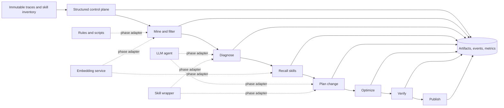

# Cost-aware architecture for skill-evolving agents

The longer-term learned configuration policy—including a transformer encoder,
typed multi-head MLP outputs,
human and verifier supervision, delayed credit assignment, and OOD category
growth—is specified in
[`learned-policy-architecture.md`](learned-policy-architecture.md).

Status: design proposal  
Date: 2026-10-23  
Scope: architecture and migration plan; no implementation is implied by this document

## Executive decision

Do not replace the complete pipeline with one opaque skill, and do not maintain
several independent implementations of the same evolution logic.

Use a **shared structured control plane** with pluggable phase implementations:

- `deterministic`: rules, scripts, hashing, schemas, thresholds, and reducers
- `embedding-service`: remotely managed embeddings and fixed-category classifiers
- `agent`: the current high-quality LLM/agent implementation
- `skill`: a lightweight skill that orchestrates tools and returns the same
  structured phase result
- `disabled` or `passthrough`: an explicit no-op implementation

The full pipeline, a mostly scripted pipeline, and a skill-first workflow are
then deployment profiles over the same contracts and event store. They are not
separate products with drifting business rules.

The non-negotiable boundary is:

> A phase implementation may reason however it wants, but it must emit a small
> validated result envelope and provenance record before the control plane can
> advance or publish a skill.

This keeps the useful properties of the current system—statistics, audit,
replay, failure isolation, and phase-level optimization—while making expensive
agent phases optional.

## Why a single end-to-end skill is insufficient

Turning the whole system into a skill reduces packaging and orchestration cost,
but an unconstrained skill invocation does not guarantee stable intermediate
artifacts. Without those artifacts, the system loses:

- a denominator for phase funnels and coverage metrics
- labeled examples for precision and recall
- per-phase latency, token, and monetary cost attribution
- deterministic replay from a known input and configuration
- evidence linking a published edit to its source finding
- the ability to replace or tune one phase independently
- reliable comparison between versions and deployment profiles

A skill-only experience is still useful as an entry point. It should call the
control-plane tools and may hide artifact details from an interactive user, but
it must not bypass the artifact protocol. A failed or interrupted skill run must
still leave a terminal phase record rather than silently omit output.

## Target architecture



### Control plane responsibilities

The control plane stays small and deterministic. It owns:

1. run identity, input hashes, configuration snapshots, and phase ordering
2. schema validation and atomic artifact writes
3. timeouts, retries, terminal failure/skip records, and idempotency
4. routing a phase to its configured adapter
5. selection gates, operation conflict reduction, and publication safety
6. append-only events and metrics derived from validated artifacts

It must not contain prompts, embedding model code, vendor-specific clients, or
skill-authoring policy.

### Phase adapter contract

Every implementation receives a versioned input manifest and returns a
versioned envelope. Large payloads remain content-addressed files referenced by
URI or relative artifact path.

```json
{
  "schema_version": 1,
  "run_id": "run-...",
  "phase": "recall",
  "item_id": "sig-...",
  "implementation": {
    "kind": "embedding-service",
    "name": "skill-recall",
    "version": "2026-10-23",
    "config_digest": "sha256:..."
  },
  "status": "completed",
  "input_refs": [{"path": "...", "sha256": "..."}],
  "output_ref": {"path": "run/.../label-matching.json", "sha256": "..."},
  "decision": {
    "disposition": "selected",
    "reason_codes": ["above_similarity_threshold"]
  },
  "measurements": {
    "wall_ms": 18,
    "service_ms": 11,
    "input_count": 1,
    "candidate_count": 5,
    "model_calls": 0,
    "input_tokens": 0,
    "output_tokens": 0,
    "estimated_cost_usd": 0.00002
  },
  "started_at": "2026-10-23T12:00:00Z",
  "finished_at": "2026-10-23T12:00:00Z"
}
```

Fields unavailable from a provider are `null`, never invented or silently
treated as zero. The current detailed JSON artifacts remain valid phase
outputs; the envelope standardizes their lifecycle and observability.

## Recommended phase cascade

The cheapest method capable of rejecting an item confidently should run first.
More expensive methods only receive the survivors.

| Stage | Default implementation | Purpose | Escalate when |
| --- | --- | --- | --- |
| Normalize | deterministic | canonicalize and redact traces | adapter cannot parse input |
| Detect | deterministic | high-precision known signals | ambiguous candidate remains |
| Semantic prefilter | embedding service | high-recall relevance/category filter | score is inside uncertainty band |
| Diagnose | rules, then agent/skill | validate cause and evolvability | rules cannot decide |
| Skill recall | embedding + metadata score | retrieve likely affected skills | no confident candidate or conflict |
| Goal | templates for simple cases, agent/skill otherwise | choose no-change/create/update/etc. | action is ambiguous or high impact |
| Optimize | script for mechanical edits, agent/skill otherwise | produce candidate change | semantic authoring is required |
| Verify | deterministic checks, optional replay | prevent regressions | behavioral evidence is required |
| Publish | deterministic | atomic promotion and history | never delegated |

Generic binary classifiers should use two thresholds, not one:

```text
score < reject_below       -> reject cheaply
score >= accept_at         -> accept cheaply
otherwise                  -> uncertain; escalate to the next implementation
```

This makes the embedding phase a filter rather than an unreviewed final judge.
Thresholds are calibrated per model and index version from labeled data.
For multi-class relevance filtering, low similarity is not evidence of noise.
Reject only when an explicit `noise` category wins above its stricter threshold
and exceeds the runner-up by the configured minimum margin; otherwise escalate.

### True no-op behavior

Do not overload a similarity threshold to mean “disabled.” With cosine
similarity, a very low threshold usually admits everything; it does not make
the phase disappear and can increase downstream cost.

Each optional phase needs an explicit mode:

- `enabled`: execute and apply its decisions
- `observe`: execute and record decisions, but do not affect routing
- `passthrough`: do not execute; emit a completed no-op envelope
- `disabled`: omit the optional phase by profile, while the control plane
  records that it was disabled

`observe` is essential for shadow testing a new filter and calculating what it
would have removed before it is allowed to change production routing.

## Standalone embedding service

Model download and inference should not occur in every pipeline or agent
container. Deploy one independently versioned service per environment, or use a
hosted provider through the same client interface.

### Service responsibilities

- load and warm the model once
- batch requests and cache by normalized content hash
- expose model name, revision, vector dimension, and normalization method
- provide embedding only; optionally provide fixed-category scoring against a
  versioned category index
- enforce request size, timeout, and tenant boundaries
- return per-request latency and cache status
- never read pipeline workspaces or publish skills

### Minimal API

```text
POST /v1/embeddings
POST /v1/classify          # text against a versioned fixed-category index
POST /v1/search            # query against a versioned skill index
GET  /v1/models
GET  /healthz
```

Every response should include `model_revision`, `index_revision`, and a stable
request ID. The pipeline stores these in the phase envelope. Index construction
is a separate offline job; production requests do not mutate an index.

### Configuration knobs

```yaml
semantic_prefilter:
  mode: observe
  endpoint: http://embedding-service:8080
  model: sentence-model-name
  model_revision: pinned-revision
  category_index: finding-categories-v1
  reject_below: 0.15       # retained for generic binary adapters
  accept_at: 0.70
  noise_accept_at: 0.75
  minimum_margin: 0.08
  top_k: 3
  batch_size: 64
  timeout_ms: 1500
  on_error: escalate
```

Useful knobs are `reject_below`, `accept_at`, `top_k`, maximum candidates,
batch size, timeout, cache policy, category allowlist, minimum margin between
the first and second result, and failure behavior. `on_error` should normally
be `escalate` or `passthrough`, not `reject`, so service failure does not lose
recall.

The implemented bootstrap values are collected in
[`tuning-guide.md`](tuning-guide.md), including the bounded edit-priority
formula and the metrics required before changing an automatic threshold.

## Structured data and metrics

Structured outputs do not by themselves create precision or recall. They make
the predictions countable; labeled ground truth supplies correctness.

Keep three separate datasets:

1. **Operational events**: every run and phase envelope; used for latency,
   cost, throughput, failure, and funnel metrics.
2. **Judgment set**: sampled findings, recalled skills, and proposed goals with
   human or adjudicated labels; used for precision, recall, and threshold
   calibration.
3. **Held-out replay set**: tasks not used for mining or authoring; used for
   behavioral lift and regression measurement.

Never tune thresholds on the held-out replay set. Store label provenance,
annotator or method, timestamp, taxonomy version, and disagreement status.

### Metric definitions

| Metric | Definition | Required evidence |
| --- | --- | --- |
| Finding precision | relevant selected findings / selected findings judged | judgment set |
| Finding recall | relevant selected findings / all relevant candidates judged | exhaustively labeled sample |
| Retrieval precision@k | relevant recalled skills / recalled skills at k | skill relevance labels |
| Retrieval recall@k | relevant recalled skills / all relevant skills | exhaustively labeled skill inventory sample |
| Filter retention | relevant items surviving filter / relevant input items | labels before and after filter |
| Escalation rate | uncertain items / phase inputs | operational events |
| Phase latency | finish minus start; report p50/p95/p99 | envelopes |
| Cost per accepted edit | total measured/estimated run cost / published edits | envelopes + publication records |
| Behavioral lift | paired pass-rate delta with and without evolved skill | held-out replay |
| False activation rate | irrelevant tasks that activate the skill / irrelevant tasks | activation eval set |

Report denominators and confidence intervals. When evidence is missing, retain
the current `null` behavior and explain what labels or replay are required.
Candidate coverage must not be renamed recall, and structural pass rate must
not be renamed behavioral lift.

### Cost accounting

Add usage fields to phase envelopes and aggregate by run, phase,
implementation kind, model, and accepted operation. Prefer provider-reported
usage and prices pinned to an effective date. If only an estimate is possible,
store `cost_source: estimated` and the price-table version.

The dashboard should expose:

- cost and wall time per phase
- survivor count and rejection count at every filter
- cost per input, selected finding, proposed operation, verified operation, and
  published edit
- savings versus the `full-agent` counterfactual measured in shadow or A/B runs
- quality deltas by profile, model revision, and threshold configuration

## Repository and code separation

Separate stable mechanics from deployment profiles and implementation plugins:

```text
skill_evolving_agents/
  core/
    contracts/             # versioned input/output schemas
    orchestration/         # state machine, routing, retries, publication
    artifacts/             # hashes, atomic writes, event store
    metrics/               # metric derivation and dashboard queries
  phases/
    mining/
      deterministic/
      embedding/
      agent/
      skill/
    diagnosis/{deterministic,agent,skill}/
    recall/{metadata,embedding,agent}/
    goal/{templates,agent,skill}/
    optimize/{scripts,agent,skill}/
    verify/{structural,replay}/
  services/
    embedding_api/         # server contract/client; model runtime can be separate repo
    index_builder/
  profiles/
    full-agent.yaml
    balanced.yaml
    low-cost.yaml
    skill-first.yaml
    offline.yaml
  skills/
    evolve-skills/         # user-facing orchestration skill
    phase-skills/          # optional phase implementations
  evaluation/
    labels/
    fixtures/
    replay/
  cli/
```

Recommended ownership boundaries:

- `core` contains no vendor SDK and no model-specific logic.
- `phases` depend on `core` contracts; `core` never imports a phase plugin.
- the embedding client contract can live here, but a heavy model server and its
  image should be independently deployable and releasable
- skills contain instructions and thin tool adapters, not duplicated scoring,
  threshold, publication, or schema logic
- profiles select implementations and knobs; they contain no Python import
  paths and may choose only explicitly registered adapters

The existing `common/pipeline_contracts.py`, `common/pipeline_metrics.py`,
recall strategies, trace-mining strategies, and runner should be migrated into
these boundaries incrementally. Do not copy them into each version.

## Deployment profiles

| Profile | Intended use | Agent usage | Expected trade-off |
| --- | --- | --- | --- |
| `full-agent` | research and quality baseline | all semantic phases | highest cost; reference quality |
| `balanced` | normal production | ambiguous diagnosis/goal/authoring only | recommended default |
| `low-cost` | large trace volumes | rare fallback only | lower cost; requires calibrated filters |
| `skill-first` | interactive/manual evolution | invoked through skill adapters | simple UX with preserved artifacts |
| `offline` | private or disconnected deployment | none | scripts and local embedding service only |

All profiles consume the same canonical input and emit the same artifact
family. This allows matched comparisons rather than anecdotal comparisons
between unrelated implementations.

## Super-config and algorithm compatibility

`config/super-config.json` is the shared registry for cross-phase knowledge.
It defines canonical contract versions, shared policy, and the algorithms that
may be selected for each phase. A deployment profile contains only the routing
choice and tunable parameters:

```json
{
  "mode": "enabled",
  "kind": "agent",
  "algorithm": "diagnosis.llm-json-no-reasoning-v1"
}
```

Each registered algorithm declares its phase, implementation kind, native
output shape, canonical input, canonical output, and normalizer. For example,
`diagnosis.agent-full-json-v1`, `diagnosis.llm-json-no-reasoning-v1`, and
`diagnosis.jev-v1` may have different native outputs, but all must normalize to
`diagnosis/v1`. Downstream recall code consumes only `diagnosis/v1`; it must not
branch on which upstream algorithm produced it.

The runner resolves the profile against the super-config before starting any
model work. Unknown algorithms, phase mismatches, kind mismatches, or
incompatible canonical contracts fail preflight. The resolved configuration and
both source digests are snapshotted under `run/config/execution-config.json`.

Per-phase envelopes record mode, algorithm, status, disposition, latency, and
available usage measurements. `logs/phase-adapter-metrics.json` groups those
records by phase, mode, and algorithm. Future threshold or algorithm tuning can
therefore compare like-for-like populations without changing downstream
contracts or parsing agent reasoning.

The model/runtime boundary sits below algorithms and is registered separately
in `config/service-tiers.json`. Tier 0 is deterministic code, tier 1 is an
embedding or small classifier service, tier 2 is compact structured generation
from a small LLM or JEV runtime, and tier 3 is a large LLM/full agent. Algorithms
declare capabilities rather than vendor/model names. Profiles may override the
service, set a maximum tier, and define escalation budgets; super-config
resolution rejects a service that lacks capabilities or exceeds the allowed
tier.

## Migration plan

### Phase 0 — baseline and freeze contracts

- Measure the current full pipeline on a fixed corpus.
- Record wall time, provider usage where available, phase funnels, failures,
  and publication outcomes.
- Create a small adjudicated judgment set for finding relevance and recalled
  skill relevance.
- Version the current phase artifacts and define the common envelope.

Exit criterion: a run can be reconstructed from immutable inputs,
configuration digest, artifacts, and events.

### Phase 1 — adapter boundary without behavior change

- Wrap current deterministic and agent phase calls behind registered adapters.
- Make the existing implementation the `full-agent` profile.
- Emit terminal envelopes for completed, failed, skipped, and timed-out phases.
- Add token/cost fields without fabricating unavailable values.

Exit criterion: output and publication behavior match the current runner on the
baseline corpus.

### Phase 2 — external embedding service in observe mode

- Implement the service client, health checks, batching, cache, and pinned
  model/index revisions.
- Add semantic prefilter, fixed-category classification, and skill recall
  adapters.
- Run them in `observe` mode and compare decisions against the judgment set and
  the full-agent baseline.

Exit criterion: latency and relevance reports include confidence intervals and
show an acceptable recall floor.

### Phase 3 — gated cascade

- Enable high-confidence rejection and acceptance bands.
- Escalate the uncertainty band and all service errors.
- Start with conservative thresholds optimized for recall, then measure actual
  downstream cost reduction.
- Keep a random sample of rejected items for continuous false-negative audit.

Exit criterion: measured cost and latency improve without exceeding agreed
quality-loss budgets.

### Phase 4 — skill-first and script-heavy profiles

- Add the user-facing evolution skill as a thin orchestrator.
- Add template/script adapters for simple, well-specified operations.
- Require the same verification and deterministic publication gate for every
  profile.

Exit criterion: profile comparisons are available in the same dashboard and a
skill invocation is fully auditable after interruption.

## Release gates and rollback

Before a new adapter, model revision, index, or threshold can affect routing:

- run it in `observe` mode
- meet a documented lower confidence bound for the required recall
- show no unacceptable regression on held-out replay
- stay within phase error and timeout budgets
- retain a sample of rejected traffic for audit
- provide a profile-only rollback to the previous implementation/configuration

Publication remains fail-closed: an embedding or agent decision may nominate a
change, but only validated verification evidence and deterministic publication
logic may update the current skill inventory.

## Initial recommendation

Build the `balanced` profile first:

1. Keep deterministic normalization, detection, contracts, metrics, and
   publication from the current pipeline.
2. Add an external embedding service for semantic prefiltering and skill
   recall, initially in `observe` mode.
3. Invoke diagnosis and goal agents only for the uncertainty band.
4. Use scripts for mechanical changes and an agent/skill adapter for semantic
   authoring.
5. Keep structural verification always on; run expensive behavioral replay for
   high-impact changes and sampled lower-risk changes.
6. Treat `full-agent` as the quality baseline and `low-cost` as an optimized
   profile, not as separate codebases.

This path attacks the largest cost multipliers—fanout and repeated semantic
reasoning—without discarding the data needed to prove whether the savings are
real or whether quality has regressed.

