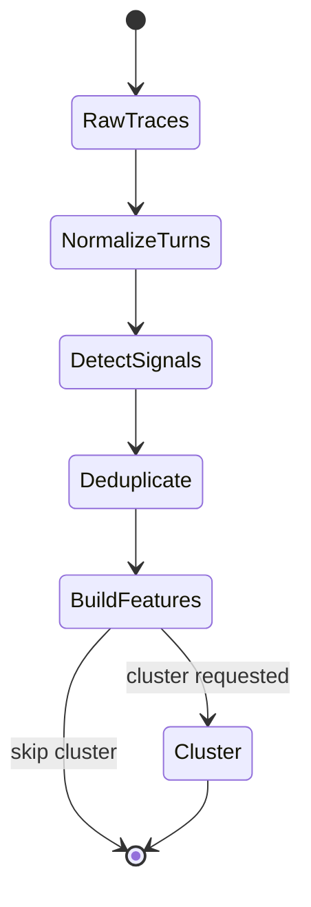
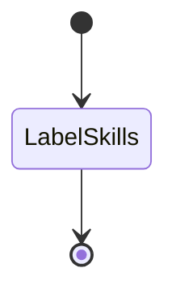
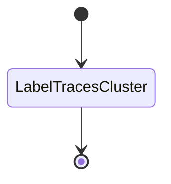
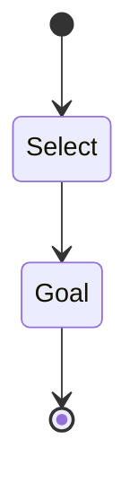
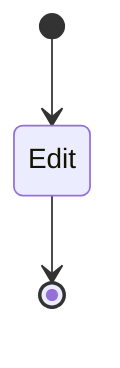
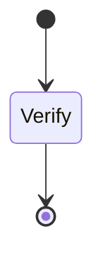
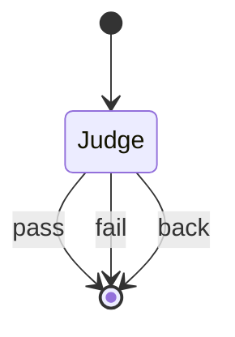

# Evolver workflow

How a container runs one session is `run-guide.md`.
Public skill-system sources, adopted mechanisms, and remaining implementation
work are tracked in `public-skill-adoption.md`.

Seven agents share one optional Docker runtime image. Deterministic scripts
normalize Codex, Claude Code, and Cursor telemetry, detect feedback signals,
deduplicate projected text, compute features, and write pointer-only manifests
before an agent sees traces. The skills agent labels existing skills once.
Diagnosis and goal then fan out by selected high-confidence finding.
Optimize takes one op from a goal, verifiter checks it, and judge ends it or
sends it back.

Normalization and slicing are deterministic. Raw system instructions,
telemetry, compaction records, base64, and redundant events never reach the
diagnosis agent. Clustering runs only when requested.

The skills agent runs once and stops when `metadata.json` is written. It does not label trace clusters, write the goal, edit a skill, or verify one.

The label traces cluster agent fans out once per selected finding. It validates
the detector evidence and diagnoses root cause without rereading raw logs.

The runner repeats the goal agent once per finding. Select recalls matching
skills and does not choose an action. Goal uses the finding, diagnosis, and
matching. A reducer removes identical operations before conflict batching.

The optimize agent stops when the edit for that op is written. Edit is Update, Generate, Delete, Merge, or Split for that op. It does not check the edit.

The verifiter agent stops when `verification.json` has status, feedback, and `ood` for that op. It does not set `action`.

The judge agent reads that file and sets `action`. `pass` ends the op. `fail` ends the op after its one retry. `back` starts the optimize agent again for that same op. Cut traces, labeling, and the goal do not run again.

| Agent | State | Does | Reads | Writes |
|---|---|---|---|---|
| | RawTraces | Immutable vendor logs | `workspace/traces/raw/{codex,claude,cursor}`, with `raw/target_agent` accepted for compatibility | |
| 01 | NormalizeTurns | Use the registered source adapter to retain user request, final response, outcome, timing, and selective tool evidence | Vendor JSONL, `trace_mining`, preprocessing config | Canonical turns, optional tool sidecars, metrics |
| 01 | DetectSignals | Run configured correction, repetition, failure, sentiment-drift, missing-response, and timing detectors | Canonical turns | Typed findings, recurring patterns, selected finding scopes |
| 01 | Cluster | Exact/MinHash-deduplicate, then use TF-IDF or external embeddings on representatives and expand pointers | Canonical turns and strategies | Dedup aliases, cut manifest, optional cluster representative/outlier manifests |
| 02.1 | LabelSkills | Label each existing skill once, until it has at least 3 labels, each with a weight | `02.1_label_skills_agent/existing_skills_labeler`, `skill_capabilites/skill_capabilites.json`, `workspace/target/to_be_improved_skills` | `workspace/target/to_be_improved_skills_metadata/metadata.json` |
| 02.2 | LabelTracesCluster | Validate one finding's evidence and diagnose its root cause | `derived/findings/<finding-id>`, taxonomy, checker | Scoped diagnosis, then reducer-owned `run/diagnosis.json` |
| 03 | Select | Fan out once per finding and recall matching existing skills | Finding, diagnosis, metadata, recall strategy | `run/<finding-id>/label-matching.json` |
| 03 | Goal | Fill the finding's goal; reducer deduplicates identical ops | Finding, diagnosis, matching, goal contracts | `run/<finding-id>/evolve-goal.json`, reduction manifest, sliced op goals |
| 04 | Update | Copy the skill into `raw_skills` if it is not there, then update the copy under `to_be_improved_skills` | Goal, `workspace/target/raw_skills` | `workspace/target/to_be_improved_skills` |
| 04 | Merge | Snapshot every source, merge them, and remove superseded source names | One-op goal | `workspace/target/raw_skills`, `workspace/target/to_be_improved_skills` |
| 04 | Split | Snapshot the source, write every result, and remove the superseded source name | One-op goal | `workspace/target/raw_skills`, `workspace/target/to_be_improved_skills` |
| 04 | Delete | Delete the skill named by the goal. No Label A to Label B match | Goal | `workspace/target/to_be_improved_skills` |
| 04 | Generate | Create a skill. No Label A to Label B match | Goal, `04_optimize_agent/skill-create` | New skill under `workspace/target/` |
| 04 | Generate | Record an out-of-distribution gap on the same create branch | Goal, `04_optimize_agent/ood-data-updater`, diagnosis | `newly_detected_skill_capabilites_missing` stays on the diagnosis |
| 05 | Verify | Execute the explicit five-step verification input. Compare each raw skill with the improved skill, evaluate every goal-derived requirement, reverse-check the changelog, and check merge/split filesystem effects. Write status and evidence per step. Leave action null | `05_verifiter_agent/verifiter`, `workspace/run/verification-input.json`, its check scripts including `verify_transforms.py`, one-op `workspace/run/evolve-goal.json`, `workspace/run/changelog.json`, `target/raw_skills`, `target/to_be_improved_skills` | input-bound step results, content-hashed changelog, overall and per-skill status, feedback, `ood`, and null action in active `workspace/run/verification.json` |
| 06 | Judge | Read this op's verifiter output. Stop, or send this op back to Edit once | `06_judge_agent/judge`, `workspace/run/verification.json`, the goal op | `feedback.action`. `pass` and `fail` end the op. `back` re-enters Edit |

`common` is the shared section and directory list. It is not a state. Select, update, merge, and split are one branch. Create and the out-of-distribution record are the other branch. Both sit in the optimize agent. Update, merge, split, and delete have no skill folder. Cluster is optional.

Deterministic preprocessing normalizes, detects, deduplicates, slices, and
optionally clusters traces. The
preprocessing agent is used only for optional cluster-name review. The skills
agent is 02.1 and runs once. Diagnosis and goal fan out once per finding.
Optimize edits one op, verifiter checks it, and judge ends it or sends it back.

Trace-mining algorithms are explicit plugins under
`01_preprocessing_agent/trace_mining/strategies`. Configuration selects one
strategy per stage through a named profile; optional experiment profiles run
against the same immutable raw traces but cannot overwrite active artifacts.
Model-use policy, prompt retention, friction signals, sentiment options,
timing metrics, and related systems are documented in
`01_preprocessing_agent/trace_mining/README.md`.

Each skill appends one JSON line to `workspace/logs/execution.jsonl` when it starts and when it finishes. A line is `{"agent": "<01>", "state": "<CutTraces>", "event": "<started|done|failed>", "at": "<iso8601>"}`. That file is audit-only. The runner advances only after process success, artifact validation, and an atomic `workspace/run/status/<stage>/<item>.json` record with `state` `done`.
